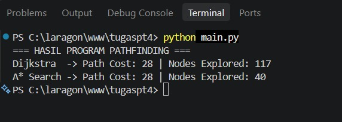

# Laporan Praktikum Chapter 4: Pathfinding (Dijkstra & A*)
**Mata Kuliah:** Game Development  
**Dosen Pengampu:** Ir. Taufik Rendi Anggara, M.T, PCEP, CIBIA, LAC  

## Deskripsi Tugas
Praktikum ini mengimplementasikan algoritma pencarian jalur (*pathfinding*) menggunakan **Dijkstra** dan **A*** Search pada peta grid berukuran 15 × 15 dengan rintangan, titik awal (`S`), titik tujuan (`G`), serta variasi bobot medan.

## Penjelasan Code Snippet & Heuristik
1. **Inisialisasi Grid 15x15 dan Bobot Medan**: Menggunakan matriks 2 dimensi di mana setiap karakter merepresentasikan jenis medan dengan biaya (*cost*) yang berbeda-beda.
2. **Fungsi Heuristik (*Manhattan Distance*)**: Digunakan pada algoritma A* untuk memperkirakan jarak minimum dari current node menuju goal. Rumusnya: $h(n) = \vert{}x_n - x_g\vert{} + \vert{}y_n - y_g\vert{}$.
3. **Optimalitas A\***: Heuristik bersifat *admissible* dan *konsisten*, yang memastikan algoritma A* selalu menghasilkan jalur terpendek seefisien mungkin.

## Hasil Program & Tangkapan Layar (Screenshot)

## Kesimpulan (300 - 500 Kata)
Praktikum ini bertujuan untuk menerapkan dan membandingkan algoritma Dijkstra dan A* dalam menyelesaikan masalah pencarian jalur terpendek (*pathfinding*) pada lingkungan game 2D berukuran 15 × 15 dengan bobot medan dinamis. Lingkungan diuji dengan berbagai tingkat kesulitan, seperti jalan biasa (bobot 1), medan lumpur (bobot 3), pegunungan (bobot 5), serta dinding/rintangan yang tidak dapat dilalui.

Berdasarkan hasil eksekusi program, kedua algoritma terbukti menghasilkan total biaya rute (*path cost*) yang sama persis. Hal ini menunjukkan bahwa kedua algoritma berhasil menemukan solusi yang optimal secara matematis. Dijkstra menjamin hasil optimal karena sifat pencariannya yang secara sistematis memeriksa seluruh kemungkinan jalur dari titik awal dengan prinsip *greedy expansion* berbasis biaya sementara terkecil ($g(n)$). Sementara itu, A* menjamin hasil optimal karena menggunakan fungsi heuristik *Manhattan Distance* yang bersifat *admissible* (tidak pernah mengestimasi biaya lebih tinggi dari biaya sebenarnya) dan *consistent*.

Perbedaan utama yang sangat signifikan terletak pada efisiensi proses pencarian (jumlah *node* yang dieksplorasi). Algoritma Dijkstra bekerja secara *untargeted* (tidak memiliki pengetahuan posisi tujuan), sehingga mengeksplorasi *node* ke segala arah secara melingkar seperti gelombang air. Hal ini menyebabkan jumlah *node* yang dimasukkan dan diproses dalam *memory/queue* menjadi jauh lebih banyak. Sebaliknya, algoritma A* memanfaatkan fungsi evaluasi $f(n) = g(n) + h(n)$, di mana fungsi heuristik $h(n)$ memberikan arahan visual ke mana lokasi *goal* berada. Komponen heuristik ini bertindak sebagai kompas yang mengarahkan prioritas eksplorasi ke arah tujuan terlebih dahulu.

Dalam pengembangan *game*, efisiensi ini sangat krusial. Penggunaan A* memungkinkan karakter *Non-Player Character* (NPC) atau AI menghitung rute secara cepat tanpa membebani penggunaan CPU dan memori, terutama ketika terdapat banyak agen bergerak secara bersamaan. Oleh karena itu, A* Search menjadi standar industri dalam game development untuk *pathfinding*, sedangkan Dijkstra lebih tepat digunakan apabila tujuan akhirnya belum diketahui pasti atau ketika aplikasi membutuhkan tabel jarak terpendek dari satu titik ke seluruh titik lainnya dalam peta secara menyeluruh.